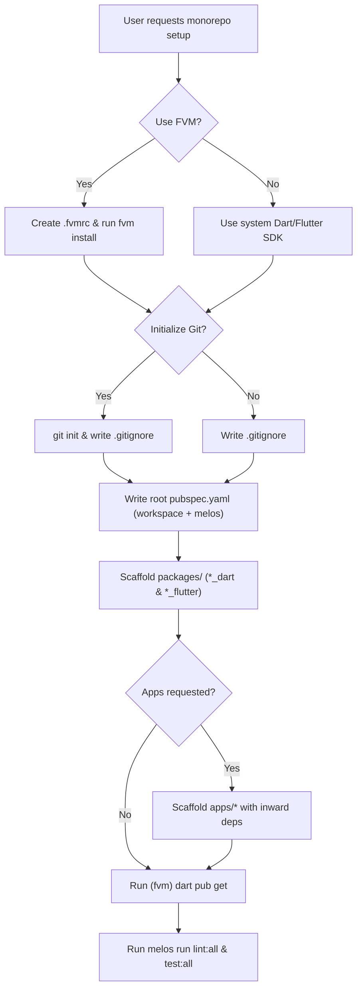

# Flutter Melos Monorepo Scaffolder

Scaffolds a lean, production-grade Dart & Flutter monorepo adhering to modern **Melos 8.x** and **Dart Pub Workspaces (Dart 3.5+)** architecture with optional **FVM** and **Git** integration.

## Core Invariants

1. **Single Source of Truth (`pubspec.yaml`)**:
   Never create a standalone `melos.yaml`. Melos 8.x embeds all workspace orchestration under the `melos:` key in the root `pubspec.yaml`.
2. **Native Pub Workspaces**:
   Subpackages declare `resolution: workspace` and resolve sibling packages directly without path overrides (`path: ../`) or `pubspec_overrides.yaml`.
3. **Inward Dependency Architecture**:
   Apps depend on Flutter UI packages; Flutter UI packages depend on pure Dart core packages. Pure Dart packages never depend on the Flutter framework (`dart:ui`).
4. **FVM SDK Delegation**:
   When FVM is active, Melos must declare `melos: sdkPath: .fvm/flutter_sdk` so all multi-package commands use the pinned SDK.
5. **Hybrid Test Runner**:
   Workspace test execution must use `melos test --no-pub`. Never execute `dart test` on Flutter packages.

---

## Scaffolding Decision Tree



---

## Input Flags & Parameters

When invoking scaffolding, parse the following options:

| Flag | Type | Default | Description |
| :--- | :--- | :--- | :--- |
| `--name=<name>` | String | Directory name | Root project name (pubspec name will be `<name>_repo`). |
| `--packages=<list>` | String | Empty | Comma-separated list of candidate domains (e.g. `auth,core`). Generates `<pkg>_dart` and `<pkg>_flutter`. |
| `--apps=<list>` | String | Empty | Comma-separated list of consumer/sandbox apps (e.g. `catalog,demo_app`). |
| `--use-fvm` | Boolean | `false` | Pins Flutter SDK channel/version and sets `sdkPath: .fvm/flutter_sdk`. |
| `--git-init` | Boolean | `false` | Runs `git init` and commits the initial scaffolding baseline. |

---

## Scaffolding Execution Recipe

### Option A: Automated CLI Runner (Recommended)
Run the bundled cross-platform Dart scaffolder from the project root:

```bash
# If using FVM:
fvm dart run .gemini/skills/flutter-melos-scaffolder/scripts/init_workspace.dart --name=my_project --packages=core,ui --apps=sandbox --use-fvm --git-init

# If using system Dart:
dart run .gemini/skills/flutter-melos-scaffolder/scripts/init_workspace.dart --name=my_project --packages=core,ui --apps=sandbox --git-init
```

### Option B: Deterministic Manual Step-by-Step

#### Step 1: Version Control & FVM Setup
1. If `--git-init` is enabled:
   ```bash
   git init
   ```
2. Copy `templates/gitignore.template` to `.gitignore`. Ensure `.fvm/*` is ignored while keeping `!.fvm/fvm_config.json`.
3. If `--use-fvm` is enabled:
   ```bash
   echo '{"flutter": "stable"}' > .fvmrc
   fvm install
   fvm use stable --skip-setup
   ```

#### Step 2: Global Linting Configuration
Copy `templates/analysis_options.yaml.template` to the workspace root as `analysis_options.yaml`.

#### Step 3: Root Workspace Pubspec
Generate root `pubspec.yaml` from `templates/root-pubspec.yaml.template`:
- Set `name: <name>_repo`.
- Set `workspace: [packages/**, apps/**]`.
- If using FVM, add `sdkPath: .fvm/flutter_sdk` under `melos:`.

#### Step 4: Subpackage Scaffolding (Inward Flow)
For each domain `<pkg>` in `--packages`:
1. **Pure Dart Core (`packages/<pkg>_dart`)**:
   - Write `packages/<pkg>_dart/pubspec.yaml` using `templates/child-dart-pubspec.yaml.template`.
   - Create `lib/<pkg>_dart.dart` and `test/<pkg>_dart_test.dart`.
2. **Flutter UI Wrapper (`packages/<pkg>_flutter`)**:
   - Write `packages/<pkg>_flutter/pubspec.yaml` using `templates/child-flutter-pubspec.yaml.template`.
   - Declare inward dependency:
     ```yaml
     dependencies:
       flutter:
         sdk: flutter
       <pkg>_dart: # Native workspace resolution, no path overrides!
     ```
   - Create `lib/<pkg>_flutter.dart` exporting `<pkg>_dart` and `test/<pkg>_flutter_test.dart`.

#### Step 5: Workspace Dependency Resolution & Verification
1. Resolve all dependencies across the entire workspace in one shot:
   ```bash
   # With FVM:
   fvm dart pub get
   # Without FVM:
   dart pub get
   ```
2. Run global static analysis and formatting checks:
   ```bash
   melos run lint:all
   ```
3. Run workspace tests across Dart and Flutter packages:
   ```bash
   melos run test:all
   ```

---

## Rationalization Table & Anti-Patterns

| Rationalization / Trap | Reality & Strict Rule |
| :--- | :--- |
| *"I should create a separate `melos.yaml` for Melos configuration."* | **PROHIBITED.** In Melos 8.x + Pub Workspaces, all config belongs under `melos:` in the root `pubspec.yaml`. Having both causes split config and sync errors. |
| *"I need to run `melos bootstrap` to link child packages."* | **OBSOLETE.** Modern pub workspaces use native linking. Simply run `fvm dart pub get` (or `dart pub get`) at the root. |
| *"I can run `dart test` across all packages to save time."* | **FATAL COMPILATION ERROR.** Flutter packages import `dart:ui` or `package:flutter`. Running `dart test` fails. Always use `melos test --no-pub`. |
| *"I will combine `run:` and `exec:` in a single Melos script."* | **SYNTAX ERROR.** In Melos 8, `run:` executes once at root; `exec:` iterates over packages. They are strictly mutually exclusive. |
| *"I should add `path: ../<pkg>_dart` to child pubspec dependencies."* | **PROHIBITED.** Native Dart workspaces automatically resolve `<pkg>_dart:` to the local workspace member. Path overrides pollute pubspecs. |
| *"I don't need `sdkPath: .fvm/flutter_sdk` in `pubspec.yaml`."* | **VERSION DRIFT.** Without `sdkPath`, Melos invokes the system Flutter SDK instead of the pinned FVM SDK, causing analyzer/SDK version mismatches. |

---

## Red Flags

If you observe any of the following, STOP and correct the workspace configuration:

- [ ] File named `melos.yaml` exists in the workspace.
- [ ] Subpackages have `path:` overrides pointing to sibling packages.
- [ ] Child packages missing `resolution: workspace`.
- [ ] `analysis-options.yaml` with a hyphen instead of `analysis_options.yaml`.
- [ ] Running `dart test` directly on Flutter packages.
- [ ] `.fvm/flutter_sdk` tracked in Git.

---

## Supporting Files & References

- [references/melos-8-fvm-rules.md](file:///D:/Workplace/Personal/packages/ammo-repo/.gemini/skills/flutter-melos-scaffolder/references/melos-8-fvm-rules.md): Detailed Melos 8 script mechanics, FVM integration, and concurrency control.
- [scripts/init_workspace.dart](file:///D:/Workplace/Personal/packages/ammo-repo/.gemini/skills/flutter-melos-scaffolder/scripts/init_workspace.dart): Runnable cross-platform initialization script.
- [templates/root-pubspec.yaml.template](file:///D:/Workplace/Personal/packages/ammo-repo/.gemini/skills/flutter-melos-scaffolder/templates/root-pubspec.yaml.template): Baseline Melos 8 root workspace pubspec.
- [templates/child-dart-pubspec.yaml.template](file:///D:/Workplace/Personal/packages/ammo-repo/.gemini/skills/flutter-melos-scaffolder/templates/child-dart-pubspec.yaml.template): Pure Dart package pubspec.
- [templates/child-flutter-pubspec.yaml.template](file:///D:/Workplace/Personal/packages/ammo-repo/.gemini/skills/flutter-melos-scaffolder/templates/child-flutter-pubspec.yaml.template): Flutter package pubspec.
